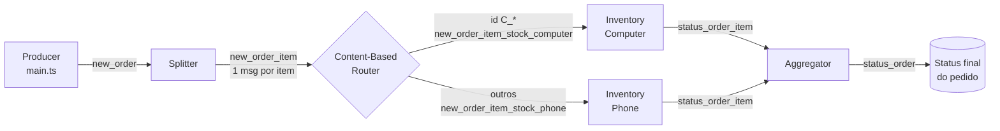
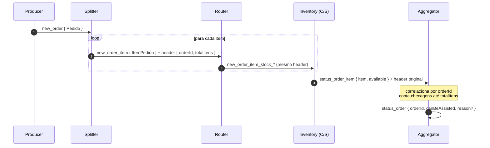

# Event-Driven Order Processing — Node.js + TypeScript

Pipeline de processamento de pedidos construído sobre **Arquitetura Orientada a Eventos (EDA)** e **Enterprise Integration Patterns (EIP)**. Um pedido de e-commerce é decomposto em mensagens, roteado por conteúdo para serviços de inventário independentes e recomposto em um status final, sem que nenhum componente conheça diretamente o outro.

A implementação atual roda **em memória** (canais sobre `EventEmitter`) para isolar os conceitos de mensageria de qualquer broker. O mesmo desenho é o ponto de partida para a migração para **RabbitMQ** (`compose.yml` e `amqplib` já estão no projeto).

---

## Sumário

- [Por que event-driven?](#por-que-event-driven)
- [Arquitetura](#arquitetura)
- [Padrões de integração aplicados](#padrões-de-integração-aplicados)
- [Contratos de mensagem](#contratos-de-mensagem)
- [Aggregator: correlação e estado](#aggregator-correlação-e-estado)
- [Como executar](#como-executar)
- [Estrutura do projeto](#estrutura-do-projeto)
- [Decisões de design e trade-offs](#decisões-de-design-e-trade-offs)
- [Do laboratório para produção](#do-laboratório-para-produção)
- [Roadmap](#roadmap)

---

## Por que event-driven?

Em um fluxo síncrono, o serviço de pedidos chamaria cada inventário diretamente, esperaria todas as respostas e falharia junto com o mais lento deles. Em escala, isso gera:

| Problema no modelo síncrono | Como a EDA resolve |
|---|---|
| **Acoplamento temporal**: todos os serviços precisam estar no ar ao mesmo tempo | O produtor publica e segue em frente; o consumidor processa quando puder |
| **Acoplamento de localização**: o pedido precisa saber o endereço de cada inventário | Os componentes conhecem apenas **canais**, nunca uns aos outros |
| **Falha em cascata**: um inventário lento derruba o checkout | Cada etapa escala e falha de forma isolada |
| **Evolução cara**: um novo tipo de produto exige alterar o serviço de pedidos | Basta um novo canal, uma nova regra no router e um novo consumidor |

É o mesmo raciocínio por trás de plataformas de alta escala que usam Kafka, SQS/SNS, Pub/Sub ou RabbitMQ para desacoplar domínios como checkout, estoque, pagamento e logística.

---

## Arquitetura



### Fluxo ponta a ponta



Os inventários processam em paralelo e com latências diferentes (1 a 3 s, simuladas). Por isso **as respostas chegam fora de ordem**, e o aggregator precisa lidar com isso.

---

## Padrões de integração aplicados

Os nomes seguem o catálogo de *Enterprise Integration Patterns* (Hohpe & Woolf).

| Padrão | Onde | Papel |
|---|---|---|
| **Message** | [`message.ts`](in-memory/message.ts) | Envelope imutável com `id`, `header` (metadados) e `payload` (dados de negócio), ambos serializados |
| **Message Channel** | [`channel.interface.ts`](in-memory/channel.interface.ts) | Abstração `send` / `subscribe`. A implementação usa `EventEmitter`, mas a interface não expõe isso |
| **Channel Registry** | [`channels.ts`](in-memory/channels.ts) | Catálogo único e congelado (`Object.freeze`) de todos os canais do sistema |
| **Splitter** | [`splitter.ts`](in-memory/splitter.ts) | Quebra um pedido em N mensagens, uma por item |
| **Correlation Identifier** | header `orderId` | Permite reassociar respostas assíncronas ao pedido de origem |
| **Content-Based Router** | [`router.ts`](in-memory/router.ts) | Escolhe o canal de destino pelo conteúdo da mensagem (prefixo do `id`) |
| **Competing / Specialized Consumers** | [`inventory-*.ts`](in-memory/) | Serviços independentes, cada um dono do seu domínio de estoque |
| **Aggregator** | [`aggregator.ts`](in-memory/aggregator.ts) | Recompõe as respostas por correlação e decide o status final do pedido |

---

## Contratos de mensagem

Os contratos são tipados em TypeScript e compartilhados entre produtor e consumidor. Quem envia e quem recebe dependem do **formato da mensagem**, e não da implementação um do outro.

```ts
// Envelope (todas as mensagens)
interface Message {
  id: string;       // UUID único por mensagem
  header: string;   // JSON com metadados de roteamento/correlação
  payload: string;  // JSON com o dado de negócio
}

// Header propagado do Splitter até o Aggregator
interface OrderItemHeader {
  orderId: string;     // Correlation ID
  totalItens: number;  // Critério de completude do aggregator
}

// Payload em status_order_item
interface ItemCheckResult {
  item: ItemPedido;
  available: boolean;
}

// Payload em status_order
interface OrderStatus {
  orderId: string;
  canBeAssisted: boolean;
  reason?: 'out_of_stock' | 'timeout';
}
```

**Regra importante:** cada etapa cria uma **nova mensagem** (novo `id`, novo payload), mas **propaga o `header` original**. Sem isso, o aggregator não saberia a qual pedido a resposta pertence nem quantas respostas esperar.

---

## Aggregator: correlação e estado

O aggregator é o único componente **com estado**. Para cada `orderId`, ele mantém uma ficha:

```ts
{ total: number; atual: number; hasFailure: boolean }
```

| Evento | Ação |
|---|---|
| 1ª checagem de um pedido | Cria a ficha com `atual: 0` |
| Toda checagem | Incrementa `atual`; se `available === false`, marca `hasFailure` |
| `atual >= total` | Publica o status: aprovado, ou reprovado com `reason: "out_of_stock"` |

### Bug corrigido: pedidos de 1 item nunca finalizavam

Na versão original, a primeira checagem só **registrava** o pedido, e a verificação de completude ficava apenas no ramo das checagens seguintes:

```ts
// antes
if (order) { order.atual++; if (order.atual >= order.total) confirm(); }
else       { map.set(orderId, { atual: 1, total }); }   // ← nunca verifica
```

Um pedido com um único item recebe uma única checagem, então **nunca gerava status**. Não havia exceção nem log de erro: a mensagem simplesmente não era publicada. É o tipo de falha mais comum (e mais perigosa) em sistemas assíncronos.

A correção separa **garantir o estado** de **processar o evento**. Assim, toda checagem passa pelo mesmo caminho:

```ts
// depois
if (!map.has(orderId)) map.set(orderId, { total, atual: 0, hasFailure: false });
const order = map.get(orderId)!;
order.atual++;
if (!checkResult.available) order.hasFailure = true;
if (order.atual >= order.total) sendOrderStatus(...);
```

---

## Como executar

**Pré-requisitos:** Node.js `>= 22.18` (execução nativa de TypeScript via *type stripping*, versão fixada em [`.node-version`](.node-version)) e `pnpm`.

```bash
pnpm install
pnpm start        # executa o pipeline em memória
pnpm typecheck    # tsc --noEmit (strict)
pnpm format       # prettier
```

Exemplo de saída (resumida):

```
[Splitter] Pedido recebido: { id: 'P_001', itens: [...] }
[INVENTORY(C)] - item Monitor 24" existe no inventário ✅
[INVENTORY(S)] - item iPhone não existe no inventário ❌
[Aggregator] (ORDER=P_001) ❌ Item indisponível: iPhone
Enviando mensagem para o canal status_order: {
  payload: '{"orderId":"P_001","canBeAssisted":false,"reason":"out_of_stock"}'
}
```

Como cada item tem 30% de chance de estar indisponível, execuções diferentes produzem pedidos aprovados e reprovados.

RabbitMQ local (para as próximas etapas):

```bash
docker compose up -d   # management UI em http://localhost:15672
```

---

## Estrutura do projeto

```
.
├── main.ts                      # entrypoint
├── in-memory/
│   ├── main.ts                  # producer: publica um pedido em new_order
│   ├── message.ts               # envelope Message + createMessage
│   ├── channel.interface.ts     # contrato Channel + createChannel (EventEmitter)
│   ├── channels.ts              # registry de canais
│   ├── splitter.ts              # Splitter (+ OrderItemHeader)
│   ├── router.ts                # Content-Based Router
│   ├── inventory-computer.ts    # consumidor: estoque de computadores
│   ├── inventory-phone.ts       # consumidor: estoque de celulares
│   ├── availableToSale.ts       # simulação de disponibilidade (chance de falha injetável)
│   ├── aggregator.ts            # Aggregator com estado por orderId
│   ├── item-check-results.ts    # contrato ItemCheckResult
│   ├── order-status.ts          # contrato OrderStatus
│   ├── pedido.interface.ts      # domínio: Pedido, ItemPedido
│   └── wait.ts                  # latência simulada
├── DESAFIO.md                   # requisitos evolutivos (falhas, fail-fast, timeout)
├── intro.md                     # contexto de domínio (MegaLoja)
└── compose.yml                  # RabbitMQ local
```

---

## Decisões de design e trade-offs

- **Canal como interface, não como implementação.** Os componentes dependem de `Channel` (`send` / `subscribe`). Trocar `EventEmitter` por RabbitMQ, SQS ou Kafka afeta apenas `createChannel`.
- **Header e payload separados e serializados.** Imita um broker real: metadados de infraestrutura (correlação, contagem) não se misturam com dados de negócio, e nada trafega por referência de memória.
- **Mensagens novas a cada etapa.** Cada transformação gera um `id` próprio, o que facilita rastreamento e, no futuro, idempotência por `message.id`.
- **Roteamento por conteúdo.** Um novo tipo de produto pede um novo canal e uma nova regra no router, sem alterar o splitter nem o aggregator.
- **Chance de falha como parâmetro** (`availableToSale(failureChance)`). Deixa o comportamento aleatório controlável em testes.
- **Estado só no aggregator.** Os demais componentes são *stateless* e podem escalar horizontalmente sem coordenação.

---

## Do laboratório para produção

A versão em memória ignora, de propósito, problemas que um sistema distribuído real precisa tratar. Ficam aqui mapeados:

| Tema | Situação atual | Em produção |
|---|---|---|
| **Durabilidade** | Mensagens se perdem se o processo cair | Broker com filas duráveis e *acks* manuais |
| **Entrega** | Exatamente uma vez (mesmo processo) | *At-least-once*: consumidores precisam ser **idempotentes** |
| **Estado do aggregator** | `Map` em memória | Store externo (Redis, DynamoDB) com TTL |
| **Mensagens que falham** | Sem tratamento | Retry com *backoff* e **Dead Letter Queue** |
| **Pedidos incompletos** | Ficam pendentes para sempre | **Timeout** no aggregator (próxima etapa) |
| **Publicação atômica** | Não se aplica | **Transactional Outbox** para não perder eventos |
| **Observabilidade** | `console.debug` | Logs estruturados com `orderId` e tracing distribuído (OpenTelemetry) |
| **Evolução de contratos** | Interfaces TypeScript | Schema registry e versionamento de eventos |

---

## Roadmap

Requisitos detalhados em [`DESAFIO.md`](DESAFIO.md).

- [x] Pipeline Splitter → Router → Inventories → Aggregator
- [x] **Nível 1**: pedidos com um único item recebem status final
- [x] **Nível 2**: inventário pode reprovar itens; status reprovado com `reason: "out_of_stock"`
- [ ] **Nível 3**: *fail-fast* (reprovar na primeira indisponibilidade), descartar checagens tardias e limpar o estado
- [ ] **Nível 4**: timeout por pedido, com cancelamento do temporizador
- [ ] Testes automatizados com `node:test`
- [ ] Migração dos canais para RabbitMQ (`amqplib`)
- [ ] Idempotência, retries e DLQ

---

## Referências

- Gregor Hohpe & Bobby Woolf — *Enterprise Integration Patterns*
- Martin Fowler — [What do you mean by "Event-Driven"?](https://martinfowler.com/articles/201701/event-driven.html)
- Chris Richardson — [Microservices Patterns: Transactional Outbox, Saga](https://microservices.io/patterns/)
